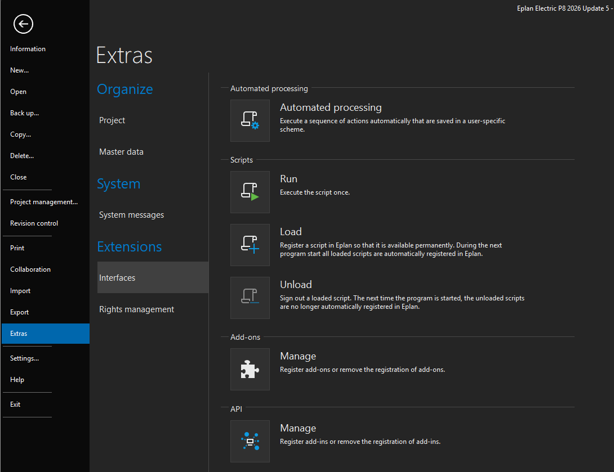
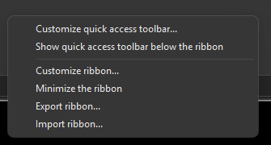
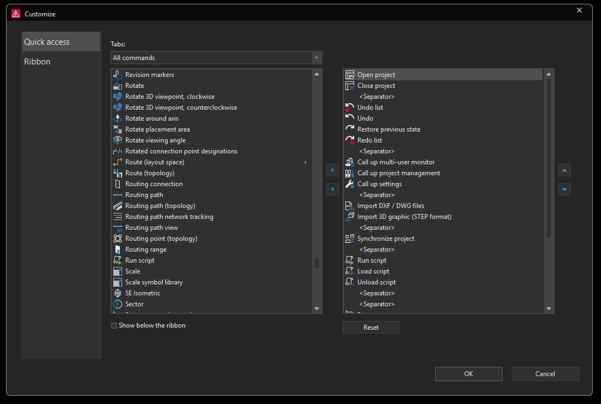

# How to run a script

Every example in this repository is a plain `.cs` file. You run it from inside Eplan. This page shows where the commands are, and how to put **Run script** on your Quick Access toolbar so it is always one click away.

## Before you start

1. Save the `.cs` file (and any other files that come with the example) in a folder on your computer, for example `C:\EplanScripts\`.
2. Open Eplan. Open a throwaway demo project if the example works with project data. Never practice on live customer data.

## Run a script

1. In Eplan, open the **File** menu and choose **Extras**, then **Interfaces**.
2. Look at the **Scripts** section. There are three commands:

   | Command | What it does |
   |---------|--------------|
   | **Run** | Executes the script once. |
   | **Load** | Registers the script in Eplan so it stays available. Loaded scripts are registered again each time Eplan starts. |
   | **Unload** | Removes a loaded script. It is no longer registered the next time Eplan starts. |

3. Choose **Run**, then select the `.cs` file.

To follow the examples you only need **Run**. Use **Load** later, when you want a script to stay registered between sessions.

## Add "Run script" to the Quick Access toolbar

The File menu is a few clicks deep. If you run scripts often, add **Run script** to the Quick Access toolbar, the small row of buttons at the top of the Eplan window.

1. **Right-click anywhere on the ribbon.** In the menu, choose **Customize quick access toolbar...**

   

2. In the **Customize** window, stay on **Quick access**. Under **Tabs**, keep **All commands**.
3. In the long list on the left, find **Run script**. The list is in alphabetical order, so look in the R section.
4. Select it and click the **right arrow** between the two lists. It moves into the list on the right, which is what appears on your toolbar.
5. Click **OK**.

   

Now one click on the toolbar button opens the same file chooser. While you are there, you can add **Load script** and **Unload script** the same way, and use the up and down arrows on the right to change their order. Tick **Show below the ribbon** if you prefer the toolbar under the ribbon.

## If something goes wrong

- Eplan shows an error and names a line: see [Troubleshooting](troubleshooting.md).
- Nothing happens: make sure a project is open if the example needs one, and that you chose **Run**, not just **Load**.
- Your edit is not showing: save the file and run it again. If you registered the script with **Load**, unload it and load it again to be safe.
