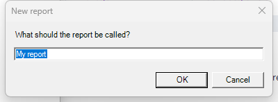

# 01 - Reusable input dialog

**Level:** Beginner  **File:** [InputDialog.cs](InputDialog.cs)

## What it does

Runs a short conversation with the user:

1. Asks for a name in a text box.
2. Handles **Cancel** and **empty input** politely.
3. Asks a Yes/No confirmation.
4. Shows a final message.

The script also contains a small `DialogHelper` class with three reusable helpers: `Prompt` (text input), `Confirm` (Yes/No), and `Info` (message). Copy that class into your own scripts and you can ask the user for things in one line.

## What you will learn

- What a class, a method, and the `[Start]` attribute are
- How to build a window (a `Form`) with a label, text box, and buttons
- How a window hands a result back to your code (`DialogResult`)
- Why you always handle Cancel and empty input
- What `null`, `if`, `return`, and `using` mean

## How to load it

1. Copy `InputDialog.cs` to a folder on your computer.
2. In Eplan 2026, open a throwaway project.
3. In Eplan, go to File > Extras > Interfaces, choose **Run** (under Scripts), and select the file.
4. Type a name, press Enter, and answer the confirmation.

New to scripts? See [How to run a script](../../docs/running-scripts.md) for the menu path and a Quick Access shortcut, and [Getting started](../../docs/getting-started.md).

## Compatibility

| Eplan version | Compiles | Run in Eplan |
|---------------|----------|--------------|
| 2026.0.3 | Yes | Yes |

The dialog logic (OK, Cancel, default text) was also exercised outside Eplan against the compiled script. It has also been run in Eplan 2026.

## Ideas to extend

- Add a second text box (for example "Report number").
- Change the `Confirm` default button, or add Yes/No/Cancel.
- Validate the input (letters and numbers only, maximum length).
- Use `Prompt` to ask for a project property value, then write it to the project (see later examples).
