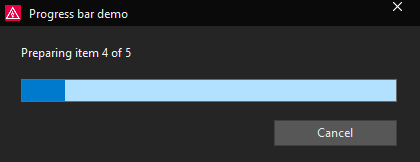
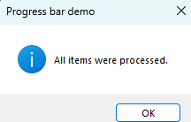
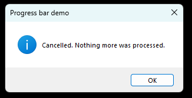

# 02 - Progress bar around a long action

**Level:** Beginner  **File:** [ProgressBar.cs](ProgressBar.cs)

## What it does

Shows Eplan's own progress window while a script works through a list of items. The job is split into two parts:

1. **Preparing**: 5 items, the first 30% of the bar
2. **Processing**: 15 items, the remaining 70%

The user can press **Cancel** at any time. When the progress window closes, a message says whether everything finished, you cancelled, or an error happened.

If the user presses Cancel, the work stops and this message appears instead:

Notice that Eplan draws its own progress window in the current theme (dark here), while a standard message box stays light. Making your own windows match is the subject of the theme examples later in this collection.

The work in the example is only a short pause per item. Replace the `Thread.Sleep(150)` line with your real work.

## What you will learn

- How to create and show Eplan's `Progress` window
- Splitting a long job into **parts**, and why the parts add up to 100%
- Counting **steps** so the bar moves smoothly
- Letting the user **cancel**, and checking for it in your loop
- `try` / `catch` / `finally`: why the progress must always be ended, even after an error
- Writing a small helper method with parameters (`RunPart`)

## How to load it

1. Copy `ProgressBar.cs` to a folder on your computer.
2. In Eplan, go to File > Extras > Interfaces, choose **Run** (under Scripts), and select the file.
3. Watch the bar fill. Run it again and press Cancel part-way.

New to scripts? See [How to run a script](../../docs/running-scripts.md) for the menu path and a Quick Access shortcut, and [Getting started](../../docs/getting-started.md).

## Good to know

- Always call `EndPart(true)` at the end (the example does it in `finally`). Eplan's own documentation warns that a progress window left open can lock Eplan.
- Call `SetNeededSteps` **after** `BeginPart`. Before it, the steps are ignored.
- Show your own message boxes only **after** the progress window has closed, or they can end up hidden behind it.
- If your work calls other Eplan actions that show their own progress, don't count steps yourself for that part, because the two can clash.
- The window only moves while your script returns control between steps, so keep each item short.

## Compatibility

| Eplan version | Compiles | Run in Eplan |
|---------------|----------|--------------|
| 2025.0.3 | Yes | Pending |
| 2026.0.3 | Yes | Yes (progress window, final message and Cancel confirmed) |

The `Progress` members used here are identical in both versions. Pressing Cancel stops the work and shows "Cancelled. Nothing more was processed."

## Ideas to extend

- Use real work: loop over pages or files instead of the fake delay.
- Add a third part, and change the percentages (they should still add up to 100).
- Show a different message per part with `SetOverallActionText`.
- Turn off the "are you sure?" prompt on Cancel with `SetAskOnCancel(false)`.
