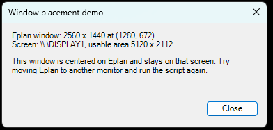

# 03 - Place a window well

**Level:** Intermediate  **File:** [WindowPlacement.cs](WindowPlacement.cs)



## What it does

Opens a small demo window that is:

- **Centered on the Eplan main window**, not just the middle of a screen
- **Owned by Eplan**, so it stays in front of Eplan and behaves as part of it
- **Hidden from the taskbar**, so users don't get an extra button
- **Always fully visible**, even if Eplan is half off a monitor or on a second screen

The demo window also tells you where Eplan is and which screen it is on, so you can see the logic working.

The reusable part is the `EplanWindowHelper` class. Copy it into your own scripts, and one line shows any window the right way:

```csharp
EplanWindowHelper.ShowDialogCentered(myForm);
```

## What you will learn

- Why `StartPosition = CenterScreen` is not enough inside Eplan (the window can open on the wrong monitor or behind Eplan)
- What a window **owner** is, and how to give a dialog one
- How to find the Eplan window from inside a script
- How to read another window's position and size
- Working with **multiple monitors** and the "working area" (the screen minus the taskbar)
- Why you set the position in the form's `Load` event
- A first look at **P/Invoke**: calling a Windows function from C#. You only need to copy those lines

## How to load it

1. Copy `WindowPlacement.cs` to a folder on your computer.
2. In Eplan 2025 or 2026, go to Utilities > Scripts, choose **Load**, select the file, then **Run**.
3. Try it with Eplan in different places: moved to another monitor, partly off the edge of a screen, and minimized.

See [Getting started](../../docs/getting-started.md) if this is your first script.

## Good to know

- If Eplan is minimized, or its window can't be found, the demo window is centered on the main screen instead. It still opens.
- The position is set in the `Load` event, right before the window appears. By then Windows has applied any display scaling, so the window's size is final and the centering is accurate.
- Placement is cosmetic, so the helper never throws an error that would stop your script.
- Later examples reuse this helper for remembering window size and position, and for matching Eplan's theme.

## Compatibility

| Eplan version | Compiles | Run in Eplan |
|---------------|----------|--------------|
| 2025.0.3 | Yes | Pending |
| 2026.0.3 | Yes | Yes |

Eplan 2025 still needs a run. The placement maths was also tested outside Eplan with stand-in windows: a normal window, one half off the edge of the screen, a minimized one, and none at all. In every case the new window landed fully on screen.

## Ideas to extend

- Add a method that also remembers where the user dragged the window (example 05 does this).
- Make the helper return a window sized as a fraction of Eplan's window.
- Center a window on another dialog instead of the Eplan main window.
