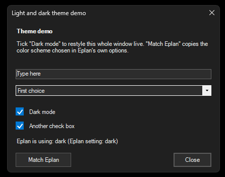
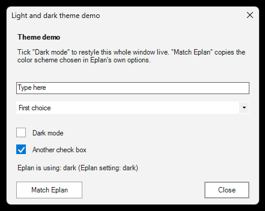

# 04 - Light and dark theme

**Level:** Intermediate  **File:** [LightDarkTheme.cs](LightDarkTheme.cs)

| Dark | Light |
|------|-------|
|  |  |

_Both screenshots were taken from the script running in Eplan 2026. The window is a normal Windows window; it just follows the color scheme you choose._

## What it does

Opens a demo window with a **Dark mode** check box. Tick it and the whole window restyles live: background, text, text box, drop-down, buttons, check boxes, and even the title bar. Untick it for light.

A **Match Eplan** button reads the color scheme chosen in Eplan's own options and sets the check box to match. The window also does this when it opens, so your tools can look right the moment they appear.

The reusable parts are `ThemeHelper`, `ThemePalette` and `ThemedCheckBox`. Copy them into your own scripts, then call:

```csharp
bool dark = ThemeHelper.IsEplanDark();   // what is Eplan using?
ThemeHelper.Apply(myForm, dark);         // restyle the form and everything on it
```

## What you will learn

- A **palette**: keeping all your colors in one place, one set for dark and one for light
- Restyling every control on a window with a loop that visits controls inside controls (recursion)
- Why the standard check box is nearly invisible in dark mode, and how to draw your own (`OnPaint`)
- Coloring the Windows **title bar** with a few lines of P/Invoke
- Reading one of **Eplan's own settings** from a script with the `Settings` class
- Falling back safely: styling is cosmetic and should never stop your script

## How Eplan's color scheme is read

Eplan keeps the choice from its options in the setting `USER.MF.GuiColorScheme`:

| Value | Meaning |
|-------|---------|
| 0 | Automatic: follows the Windows "apps" theme |
| 1 | Dark |
| 2 | Light |

The script reads that setting. For 0 it asks Windows (the `AppsUseLightTheme` registry value). If anything fails, it uses dark, which is Eplan's default. This is more reliable than guessing from pixels on the screen.

The meaning of the values comes from Eplan's own configuration files. With Eplan 2026 set to dark (value 1), the script reports "Eplan setting: dark". The values 0 (automatic) and 2 (light) have not been tried inside Eplan yet. If you change the scheme in Eplan, Eplan may need a restart before it shows it, and the setting is what the script reads.

## How to load it

1. Copy `LightDarkTheme.cs` to a folder on your computer.
2. In Eplan 2025 or 2026, go to Utilities > Scripts, choose **Load**, select the file, then **Run**.
3. Tick and untick **Dark mode**. Click **Match Eplan**. Compare the window with Eplan itself.

See [Getting started](../../docs/getting-started.md) if this is your first script.

## Good to know

- Some standard controls ignore colors. The **date picker** stays white, and the drop-down arrow of a **combo box** stays light, in dark mode. Later examples draw replacements.
- The title bar color needs Windows 10 or 11. The caption and text colors only work on Windows 11. On older systems the title bar stays standard, and the rest still works.
- The code is wrapped in `try`/`catch`, so a styling problem can never block a window from opening.
- Each example script is compiled on its own, so these helper classes carry a `Theme` prefix. If you combine several scripts into one Visual Studio project, keep class names unique.

## Compatibility

| Eplan version | Compiles | Run in Eplan |
|---------------|----------|--------------|
| 2025.0.3 | Yes | Pending |
| 2026.0.3 | Yes | Yes (Eplan set to dark) |

Tick and untick change every color as expected, and the script correctly read Eplan 2026's dark setting. Still to confirm: Eplan set to light or automatic, and Eplan 2025. The setting and the `Settings` methods exist in both versions.

On screen, text can show faint orange and blue edges in a screenshot. That is normal Windows text smoothing (ClearType), not a wrong color.

## Ideas to extend

- Remember the user's choice instead of reading Eplan's (see the settings example).
- Add a third choice, "Automatic", that always follows Eplan.
- Style a `DataGridView`, `ListBox` or `TabControl` the same way.
- Draw your own date picker for dark mode.
