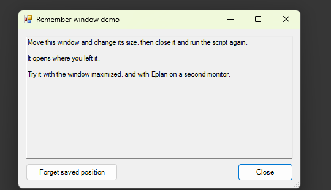

# 06 - Remember window size and position

**Level:** Intermediate  **File:** [RememberWindow.cs](RememberWindow.cs)  **Status:** Run in Eplan 2026



## What it does

Opens a resizable demo window. Move it, resize it, maximize it, then close it. The next time you run the script, it opens exactly where you left it. A **Forget saved position** button clears the memory.

It is also safe: if the saved position is no longer on any screen (for example you unplugged a monitor), the window opens in the centre of the screen instead of out of reach.

The reusable part is the `WindowMemory` class. Copy it into your own scripts, then add one line after you set a form up:

```csharp
WindowMemory.Attach(myForm, "MyWindowName");
```

## What you will learn

- Saving small per-user settings in the Windows **registry**, without administrator rights
- Reacting to the form's **FormClosed** event
- Why a maximized window must save `RestoreBounds`, not `Bounds`
- Checking the saved spot against all the **screens** that exist now
- Writing code that fails quietly, because remembering a position is only a convenience

## How to run it

1. Copy `RememberWindow.cs` to a folder on your computer.
2. In Eplan, go to File > Extras > Interfaces, choose **Run** (under Scripts), and select the file.
3. Move and resize the window, close it, and run the script again.

New to scripts? See [How to run a script](../../docs/running-scripts.md).

## Good to know

- Values are stored under `HKEY_CURRENT_USER\Software\EplanScriptExamples\Windows\<key>`. Give each of your windows its own key.
- The window is saved when it closes normally. A window that is closed by a crash saves nothing.
- Example 03 shows how to centre a window on Eplan the first time, before anything is saved.

## Compatibility

| Eplan version | Compiles | Run in Eplan |
|---------------|----------|--------------|
| 2026.0.3 | Yes | Yes (saved, restored, off-screen fallback, forget) |

Checked in Eplan 2026: the window reopened at the saved position and size after being moved and resized, opened centered when the saved position was far off every screen (a stand-in for an unplugged monitor), and stayed forgotten after 'Forget saved position' and Close. Not yet tried: maximized, and Eplan on a second monitor.

The save and restore logic, including an off-screen saved position, was also tested outside Eplan.

## Ideas to extend

- Remember the position of a splitter or the width of a grid column too.
- Store the values in the JSON settings file from example 08 instead of the registry.
- Remember whether the window was maximized.
