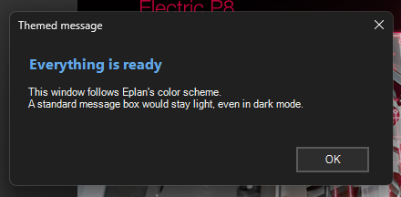
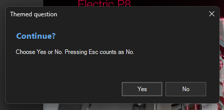

# 07 - Themed message and confirm window

**Level:** Beginner  **File:** [ThemedMessage.cs](ThemedMessage.cs)  **Status:** Run in Eplan 2026 (dark, light and automatic with Windows in light mode)




## What it does

Shows a message, then a Yes/No question, then your answer, in a small window that follows **Eplan's own color scheme** (dark or light), including the title bar. A standard Windows message box always stays light, which looks out of place next to a dark Eplan.

Use it like this anywhere in your own scripts:

```csharp
NoticeWindow.Show("Title", "Short heading", "More detail.");
bool yes = NoticeWindow.Ask("Title", "Continue?", "Choose Yes or No.");
```

## What you will learn

- Why a standard message box ignores your color scheme
- Building your own small dialog and returning `true` or `false`
- Making **Esc** act as **No**, and **Enter** as the default button
- Reading Eplan's color scheme from its setting (the same technique as example 04)
- Giving every message a short heading that says what happened

## How to run it

1. Copy `ThemedMessage.cs` to a folder on your computer.
2. In Eplan, go to File > Extras > Interfaces, choose **Run** (under Scripts), and select the file.
3. Switch Eplan between dark and light in its options, restart Eplan if it asks, and run it again.

New to scripts? See [How to run a script](../../docs/running-scripts.md).

## Good to know

- Long text is cut off at about four lines. For longer reports, use a window with a scroll bar (see the results window example).
- If Eplan's setting cannot be read, the window uses dark, which is Eplan's default.
- Example 04 explains the colors, the title bar and the setting in more detail.

## Compatibility

| Eplan version | Compiles | Run in Eplan |
|---------------|----------|--------------|
| 2026.0.3 | Yes | Yes (dark, light, and automatic with Windows light: message, Yes/No question, answer window; dark also Esc as No) |

A later run (2026-11-07) used Eplan set to light and then to automatic with Windows in light mode: the message, the Yes/No question (answered Yes with light, No with automatic) and the answer window all opened with light colors. Not tried: automatic with Windows set to dark mode. The color technique is the same as in example 04.

## Ideas to extend

- Add an icon next to the heading (information, warning or error).
- Add a third choice, such as Yes / No / Cancel.
- Add a "Don't ask me again" check box that remembers the answer (see example 08).
