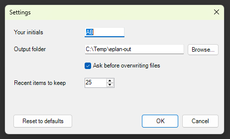

# 08 - Settings dialog that saves preferences

**Level:** Beginner  **File:** [SettingsDialog.cs](SettingsDialog.cs)  **Status:** Run in Eplan 2026



## What it does

Shows a settings window with four options (your initials, an output folder, a check box and a number). **OK** saves them, **Cancel** keeps what was there, and **Reset to defaults** puts the default values back in the boxes. The next time you run the script, the window opens with the values you saved.

The settings are kept in a small, readable text file:

```
%APPDATA%\EplanScriptExamples\settings.json
```

## What you will learn

- A **settings class** with default values
- Turning an object into JSON text and back with **Newtonsoft.Json**, which Eplan lets scripts use
- Handling a **missing or damaged file** without crashing
- The usual **OK / Cancel / Reset** pattern: change a copy, save only on OK
- Where per-user files belong (the AppData folder)

## How to run it

1. Copy `SettingsDialog.cs` to a folder on your computer.
2. In Eplan, go to File > Extras > Interfaces, choose **Run** (under Scripts), and select the file.
3. Change something, press OK, and run it again. Open the JSON file in a text editor to see what was saved.

New to scripts? See [How to run a script](../../docs/running-scripts.md).

## Good to know

- To add an option, add one field to `ScriptSettings`, one control to the window, and two lines to copy the value in and out. Old files without the new option simply use its default.
- Settings are per Windows user. For team-wide settings, point the file path at a shared folder.
- Never store passwords in a settings file like this.

## Compatibility

| Eplan version | Compiles | Run in Eplan |
|---------------|----------|--------------|
| 2026.0.3 | Yes | Yes (save, restore, reset to defaults, cancel) |

Checked in Eplan 2026: values typed into the window were written to the JSON file, the same values came back the next time the window opened, 'Reset to defaults' changed the fields, and Cancel left the saved file untouched. This also confirms that Newtonsoft.Json can be used directly in an Eplan script.

The load, save, damaged-file and reset behavior was also tested outside Eplan.

## Ideas to extend

- Use the saved theme choice with example 04, or the saved window position with example 06.
- Add a "Don't ask again" setting for the themed message window (example 07).
- Keep a list of recently used folders.
