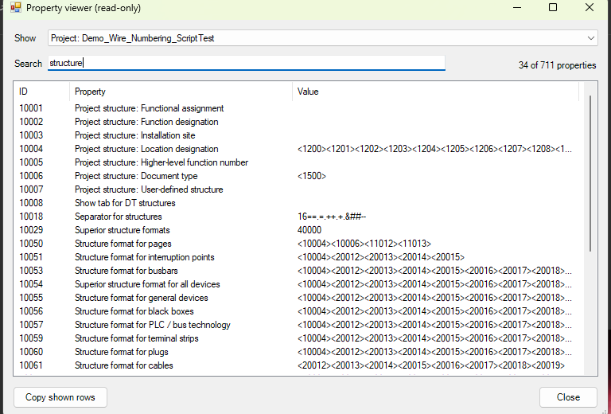

# 10 - Property viewer

**Level:** Advanced  **File:** [PropertyViewer.cs](PropertyViewer.cs)  **Status:** Run in Eplan 2026

*Read-only: this example never changes your project.*

## What it does

Shows **every property** of the project, or of whatever you have selected in Eplan, as a table of **ID, property name and value**. Choose what to look at in the drop-down at the top, type words to search, and press **Copy shown rows** to paste the result into a spreadsheet or an email.

It is a quick way to answer *"what property holds this, and what is its number?"*, for example when you are writing a script that needs a property ID.

## What you will learn

- Reading the **current selection** from a script, and why it must be **unlocked** first (`LockSelectionByDefault`)
- Reading every property of an object through reflection (`ExistingIds` and `ExistingValues`)
- Handling **multi-language** property values (`en_US@Text;de_DE@Text;`)
- Filtering a table by several words

## How to run it

1. Open a project in Eplan. **Select** the object(s) you want to inspect first (a page in the page navigator, a device in the drawing).
2. Copy `PropertyViewer.cs` to a folder on your computer.
3. Go to File > Extras > Interfaces, choose **Run** (under Scripts), and select the file. It works best from a ribbon button or the Quick Access toolbar, so the selection is kept.
4. Pick an item in the **Show** drop-down.

New to scripts? See [How to run a script](../../docs/running-scripts.md).

## Good to know

- If nothing is selected, you can still look at the project's own properties.
- Only the first 50 selected objects are offered.
- Property names are shown in your Eplan's language.
- This example uses reflection (see example 09) and is **likely to need a small adjustment** after the first run. Please report any error message exactly.

## Compatibility

| Eplan version | Compiles | Run in Eplan |
|---------------|----------|--------------|
| 2026.0.3 | Yes | Yes (project and page properties, search, copy) |

Checked in Eplan 2026: the project's 711 properties were listed with their ID, name and value, searching narrowed them, and after a page was selected in the page tree the Show list offered that page too, listing its 381 properties. Copy shown rows put the rows on the clipboard. Tip: the project list includes things like the last editor's name and e-mail, so check a window before you share a screenshot of it.

The member names used were checked against the installed 2026 assemblies. The reflection helper was tested outside Eplan against stand-in objects.

## Ideas to extend

- Show only properties that have a value.
- Add the property ID to a "copy as script line" button.
- Compare two selected objects side by side.
