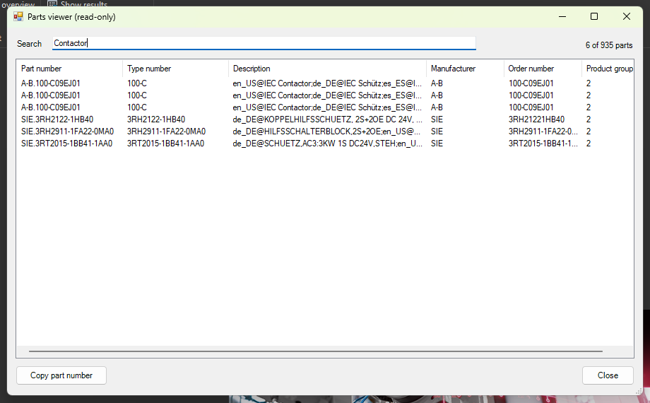

# 11 - Parts viewer with filter box

**Level:** Intermediate  **File:** [PartsViewer.cs](PartsViewer.cs)  **Status:** Run in Eplan 2026

*Read-only: this example never changes the parts database.*

## What it does

Loads the parts database into a table (part number, type number, description, manufacturer, order number and product group) and lets you **narrow it down as you type**. Every word you type must appear somewhere in the row, so `siemens relay 24` finds what you expect. **Copy part number** puts the selected part number on the clipboard.

It asks before loading, because a big parts database can hold hundreds of thousands of parts. The window shows the first 2000 matches, and the status line says how many parts match in total.

## What you will learn

- Using Eplan's **MasterData** classes directly: `MDPartsManagement`, `MDPartsDatabase` and `MDPart` are available to scripts by default, so no reflection is needed
- Reading part properties (`ARTICLE_PARTNR`, `ARTICLE_TYPENR`, `ARTICLE_DESCR1`, ...)
- Closing a database again in a `finally` block
- Protecting the window against a **huge result list**
- Filtering by several words

## How to run it

1. Copy `PartsViewer.cs` to a folder on your computer.
2. In Eplan, go to File > Extras > Interfaces, choose **Run** (under Scripts), and select the file.
3. Answer **Yes**, wait for the table, then type in the search box.

New to scripts? See [How to run a script](../../docs/running-scripts.md).

## Good to know

- It reads the parts database that is currently set up in Eplan.
- Loading is the slow part. Filtering after that is instant.
- Some parts have empty fields. They show as blank cells.
- Whether `OpenDatabase()` and an empty filter return the whole database on every setup (including SQL Server databases) is something this example tests, so please report what you see.

## Compatibility

| Eplan version | Compiles | Run in Eplan |
|---------------|----------|--------------|
| 2026.0.3 | Yes | Yes (935 parts loaded, search, copy part number) |

Checked in Eplan 2026 with the parts database of the demo project's setup: the MasterData parts classes worked directly from a script (no reflection needed). Loading 935 parts took about 5 seconds, the empty search showed all of them ('935 of 935 parts'), searching for Contactor narrowed it to 6, and Copy part number put the selected part number on the clipboard.

The class and property names used were checked against the installed 2026 MasterData assembly.

## Ideas to extend

- Load only parts whose manufacturer matches a value (`MDObjectFilter.AddPropertyCondition`).
- Add more columns, such as price or the supplier.
- Export the filtered list to CSV (see example 09).
