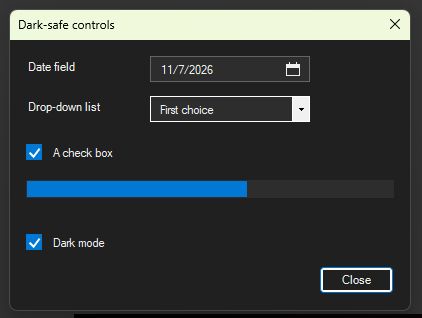
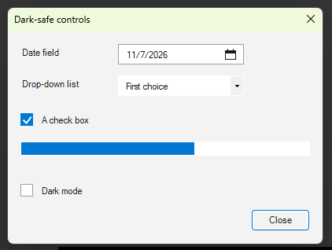

# 13 - Dark-mode-safe controls

**Level:** Intermediate  **File:** [DarkSafeControls.cs](DarkSafeControls.cs)  **Status:** Run in Eplan 2026

## What it does

Shows four controls that look right on both a dark and a light background, with a **Dark mode** check box to switch between them:

| Control | Why the standard one is a problem |
|---------|-----------------------------------|
| `SafeCheckBox` | The flat check box is almost invisible in dark mode |
| `SafeDateField` | The standard date picker cannot be colored and stays white |
| `SafeComboBox` | The list items and the selected text stay light (the small arrow box is still drawn by Windows and may stay light) |
| Progress bar | Takes its colors once the system look is switched off with `SetWindowTheme` |

Copy the controls you need into your own scripts. Each one is given a palette with `SetColors(...)`, so it follows whatever scheme your window uses (see example 04 for reading Eplan's scheme).

## What you will learn

- **Custom painting**: overriding `OnPaint` to draw a control yourself
- Building a control by inheriting from another (`class SafeCheckBox : CheckBox`)
- Showing a pop-up calendar with a `ToolStripDropDown`
- Drawing the items of a list yourself with `OwnerDrawFixed`
- Switching off the system look for one control with `SetWindowTheme`
- Passing colors in with a small **palette** class

## How to run it

1. Copy `DarkSafeControls.cs` to a folder on your computer.
2. In Eplan, go to File > Extras > Interfaces, choose **Run** (under Scripts), and select the file.
3. Click the date field to open the calendar. Untick **Dark mode** and tick it again.

New to scripts? See [How to run a script](../../docs/running-scripts.md).

## Good to know

- The title bar is not colored in this example. Example 04 shows how.
- Pop-up calendars and drop-down lists are drawn by Windows. Their colors can look different between Windows versions, so check them on your machine.
- The date field shows the short date format of your Windows settings.
- Custom controls are more work than standard ones. Use them only where the standard control really looks wrong.

## Compatibility

| Eplan version | Compiles | Run in Eplan |
|---------------|----------|--------------|
| 2026.0.3 | Yes | Yes (dark and light) |

Checked in Eplan 2026 with Eplan in dark mode: the date field, calendar button, drop-down list (its open list is dark too), check box and progress bar all follow the colors, and the Dark mode check box switches them live. Two small things to know: the calendar that pops open from the date field is drawn by Windows and stays light, and in light mode the little arrow box of the drop-down stays dark.

## Ideas to extend

- Draw the drop-down arrow yourself as well (override the control's paint message).
- Make the date field accept typing as well as clicking.
- Add keyboard support to the check box (Space to toggle).
- Style a `DataGridView` header and grid lines to match.
