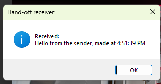

# 15 - Hand a value from one script to another

**Level:** Advanced  **Files:** [HandOffSender.cs](HandOffSender.cs), [HandOffReceiver.cs](HandOffReceiver.cs)  **Status:** Run in Eplan 2026

## What it does

Two scripts cooperate. **HandOffSender.cs** leaves a short note (a value plus a timestamp), then starts **HandOffReceiver.cs**. The receiver picks the note up, shows it, and clears it. If the note is older than 60 seconds, the receiver ignores it, so a forgotten value can never be used by accident later.

This is how one ribbon button or script can pass a setting, a mode or a name to another script.

## What you will learn

- Using `AppDomain.CurrentDomain.SetData` and `GetData` as a short-term shared note between scripts in the same Eplan session
- Adding a **timestamp** so old values expire
- Starting another script from code with the `ExecuteScript` action and an `ActionCallingContext`
- Clearing a value after it is read, so it is used once

## How to run it

Keep both files in one folder.

1. In Eplan, go to File > Extras > Interfaces, choose **Run** (under Scripts), and select `HandOffSender.cs`.
2. When asked, select `HandOffReceiver.cs`.
3. A message shows the value the receiver picked up.
4. To see the "too old" and "nothing waiting" cases, run `HandOffReceiver.cs` on its own.

New to scripts? See [How to run a script](../../docs/running-scripts.md).

## Good to know

- The note lives only as long as Eplan is running. It is not saved to disk.
- Both scripts must use the same key text. Make it unique so it cannot clash with another tool.
- Do not pass secrets this way. Any script in the same Eplan session can read the note.
- Whether scripts really share one AppDomain in your Eplan version is the thing this example tests, so please report what you see.

## Compatibility

| Eplan version | Compiles | Run in Eplan |
|---------------|----------|--------------|
| 2026.0.3 | Yes | Yes (value passed between two scripts, empty case) |

Checked in Eplan 2026: the sender's value reached the receiver script ('Hello from the sender' with the time it was made), so two scripts run in the same Eplan session can share short-lived values this way. Running the receiver again straight afterwards found nothing waiting, because the value is taken once, and it reported that clearly.

The receiver's freshness and parsing logic was tested outside Eplan.

## Ideas to extend

- Pass several values by joining them with a separator, or as a small JSON text (see example 08).
- Have a ribbon button pass its own name to a shared script.
- Use the note to remember the last folder between two scripts.
