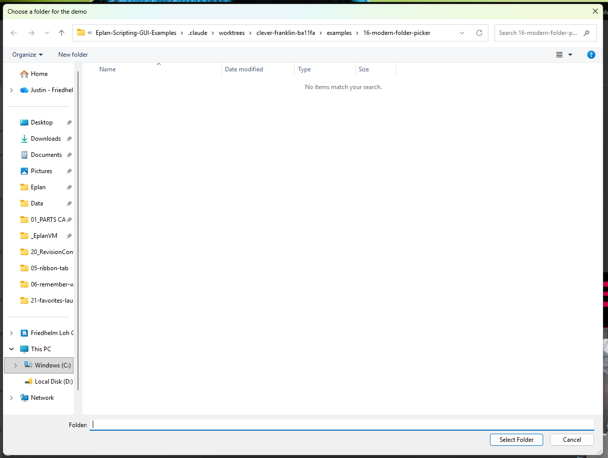

# 16 - Modern folder picker

**Level:** Advanced  **File:** [ModernFolderPicker.cs](ModernFolderPicker.cs)  **Status:** Run in Eplan 2026



## What it does

Shows the modern Windows **"choose a folder"** window, the Explorer-style one with an address bar, Quick access, Favorites and search. The .NET Framework's own `FolderBrowserDialog` is the older tree-style window, so this example reaches the modern one through Windows itself.

The reusable part is `ModernFolderPicker`. Copy it into your own scripts:

```csharp
string folder = ModernFolderPicker.Pick("Choose the export folder", null);
if (folder == null) { /* the user cancelled */ }
```

## What you will learn

- What **COM interop** is: describing a Windows component to C# so you can call it
- Why the **order of methods** in an interface declaration must match Windows exactly
- What an **HRESULT** is, and how to recognize "the user cancelled"
- Setting dialog options with flags, and giving the window a title and a starting folder
- Failing quietly: returning `null` instead of crashing

## How to run it

1. Copy `ModernFolderPicker.cs` to a folder on your computer.
2. In Eplan, go to File > Extras > Interfaces, choose **Run** (under Scripts), and select the file.
3. Choose a folder, then run it again and press Cancel.

New to scripts? See [How to run a script](../../docs/running-scripts.md).

## Good to know

- If anything goes wrong, `Pick` returns `null`. You can fall back to `FolderBrowserDialog` in that case.
- The window is shown without an owner, so it appears in the normal place. Showing it owned by Eplan would be the next improvement.
- This is advanced code. If it feels like too much, the simple route (used in example 05) is to ask for a **file** with `OpenFileDialog` and use that file's folder.

## Compatibility

| Eplan version | Compiles | Run in Eplan |
|---------------|----------|--------------|
| 2026.0.3 | Yes | Yes (choose a folder, Cancel) |

Checked in Eplan 2026: the Explorer-style window opened, choosing a folder returned its path, and Cancel returned nothing, which the script reported as 'No folder was chosen.'

The window was opened and cancelled programmatically outside Eplan to confirm the COM declarations match Windows.

## Ideas to extend

- Pass an owner window handle to `Show` so the dialog stays in front of Eplan.
- Add a version that allows several folders (the `FosAllowMultiSelect` flag and `IFileOpenDialog.GetResults`).
- Remember the last folder with the settings file from example 08.
