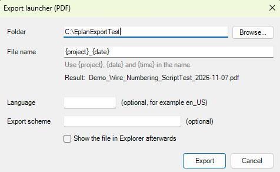

# 17 - Export launcher (PDF)

**Level:** Intermediate  **File:** [ExportLauncher.cs](ExportLauncher.cs)  **Status:** Run in Eplan 2026

## What it does

A small window that exports the **current project** to one PDF file with a name you choose from a pattern:

- **Folder** to save in
- **File name** built from `{project}`, `{date}` and `{time}`, with a live preview (for example `MyProject_2026-11-07.pdf`)
- Optional **language** and **export scheme**
- Optionally shows the new file in Explorer afterwards

It remembers your last choices. It asks before replacing a file that already exists. It uses Eplan's own `export` action, so you get the same PDF as the normal export, just with fewer clicks and a consistent file name.

## What you will learn

- Running an **Eplan action with parameters** from a script (`TYPE`, `EXPORTFILE`, `LANGUAGE`, `EXPORTSCHEME`)
- Building a **file name from a pattern** and removing characters Windows does not allow
- Remembering the last choices in a small JSON file
- Asking before overwriting, and catching errors from an action
- Opening Explorer with a file selected

## How to run it

1. Open a **copy of a project** in Eplan.
2. Copy `ExportLauncher.cs` to a folder on your computer.
3. Go to File > Extras > Interfaces, choose **Run** (under Scripts), and select the file.
4. Check the file name preview, then press **Export**.

New to scripts? See [How to run a script](../../docs/running-scripts.md).

## Good to know

- The project name comes from Eplan's path variable `$(PROJECTNAME)`. If your Eplan does not supply it, the name shows as `Project`. Please report what you see.
- Eplan adds the `.pdf` extension. Do not type it in the pattern.
- Leave **Export scheme** empty to use the scheme you used last in Eplan. The language code is case-sensitive.
- Exporting only some pages is a different action type (`PDFPAGESSCHEME`) and a possible extension.

## Compatibility

| Eplan version | Compiles | Run in Eplan |
|---------------|----------|--------------|
| 2026.0.3 | Yes | Yes (whole-project PDF on a copy, renamed to the pattern) |

Checked in Eplan 2026 on a copy of a demo project: the preview showed the project name correctly, the export action wrote one PDF of all 129 pages (about 8 MB, roughly 30 seconds), and the 'file already exists' question appeared with No as the default. Eplan 2026 ignored the file name that was passed to the export action and named the PDF itself (project name, date and time), so the script finds the file the action just made and renames it to the name from your pattern.

The file name pattern and the saved options were tested outside Eplan.

## Ideas to extend

- Add a drop-down of your export schemes.
- Add the other export types (DXF, per-page PDFs) as choices.
- Report the result with the results window (example 22).
