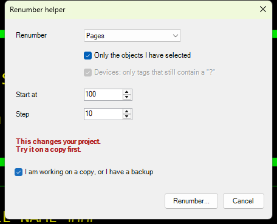

# 19 - Renumber helper

**Level:** Intermediate  **File:** [RenumberHelper.cs](RenumberHelper.cs)  **Status:** Run in Eplan 2026

> **This changes your project.** Try it on a copy first.

## What it does

A friendly window in front of Eplan's own `renumber` action. Choose what to renumber (devices, pages, terminals, cables or connections), whether to renumber only the objects you have selected, and the start value and step. For devices you can limit it to tags that still contain a `?`.

Two safety steps protect you: the **Renumber...** button stays disabled until you tick "I am working on a copy, or I have a backup", and a final **Yes/No** question repeats in plain words what is about to happen.

## What you will learn

- Running the `renumber` action with `TYPE`, `USESELECTION`, `STARTVALUE`, `STEPVALUE` and `POSTNUMERATE`
- Enabling and disabling controls depending on other choices
- Holding a user's choices in one small object and passing it on
- Adding a deliberate safety step before a project-changing action

## How to run it

1. Open a **copy of a project** in Eplan.
2. Copy `RenumberHelper.cs` to a folder on your computer.
3. Go to File > Extras > Interfaces, choose **Run** (under Scripts), and select the file.
4. Choose what to renumber, tick the safety box, press **Renumber...**, and confirm.

To renumber only some objects, select them in Eplan first and tick "Only the objects I have selected".

New to scripts? See [How to run a script](../../docs/running-scripts.md).

## Good to know

- The action does what Eplan's numbering function does with your configured numbering scheme. This window only chooses the options.
- Some parameters only apply to some types. The device-only option is disabled for the others.
- The start value and step also apply to pages, terminals and cables, as Eplan documents.
- Whether you can undo the result depends on Eplan. Work on a copy.

## Compatibility

| Eplan version | Compiles | Run in Eplan |
|---------------|----------|--------------|
| 2026.0.3 | Yes | Yes (pages and cables changed as expected; devices, terminals and connections ran but showed no change) |

Checked in Eplan 2026 on a copy of a demo project: the button stayed disabled until the 'working on a copy' box was ticked, the confirmation described exactly what would happen (pages, only the selected ones, start 100, step 10), and after Yes the three selected pages were renumbered /100, /110 and /120 while the other pages kept their numbers. A later run (2026-11-07) tried the other types on the same copy, each with 'only the objects I have selected' and one object selected in its navigator, and the confirmation described each one correctly. Cables: cable CBL1 became CBL50 (start 50, step 5) and the other cables kept their names. Devices (one device, all tags, start 200), terminals (one terminal, start 20) and connections (one connection, start 700): Eplan reported 'The renumber action finished' with no error, but the name shown in the navigator did not change, so an effect was not confirmed for these three. Those are one-object tests; whether they change anything depends on the project's numbering scheme, and 'only tags that still contain a ?' for devices was not tried because the demo has no such tags.

## Ideas to extend

- Add the optional `IDENTIFIER` filter (for example `X*`) for devices.
- Offer a numbering scheme choice (`CONFIGSCHEME`).
- Report what happened with the results window (example 22), and make a backup first (example 26).
