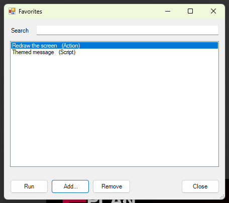

# 21 - Favorites launcher

**Level:** Intermediate  **File:** [FavoritesLauncher.cs](FavoritesLauncher.cs)  **Status:** Run in Eplan 2026



## What it does

Opens a window with your own list of favorite **scripts** and **Eplan actions**. Type in the search box to filter the list as you type, then press Enter or double-click to run the one you want. **Add...** puts a new favorite in the list, **Remove** takes one out. The list is saved between runs.

It is a personal shortcut list: one place for the scripts you use every day, without hunting through folders or menus.

The list is a small readable file:

```
%APPDATA%\EplanScriptExamples\favorites.json
```

## What you will learn

- Filtering a `ListBox` as the user types
- Saving and loading a list of objects as JSON
- Running a **script file** with the `ExecuteScript` action, and an **Eplan action** by its name, with `CommandLineInterpreter`
- Why you run the chosen item **after** your window has closed
- Validating input in an Add window before it closes

## How to run it

1. Copy `FavoritesLauncher.cs` to a folder on your computer.
2. In Eplan, go to File > Extras > Interfaces, choose **Run** (under Scripts), and select the file.
3. Click **Add...**, choose **Script**, browse to one of your scripts (for example one of the examples in this repository), and press OK. Double-click it, or select it and click Run.

New to scripts? See [How to run a script](../../docs/running-scripts.md).

## Good to know

- The first time, the list holds one harmless sample (redraw the screen).
- For an action with parameters, write it like Eplan's command line: the action name followed by `/PARAMETER:value` pairs.
- You can also put this launcher on a ribbon button (example 05) or on the Quick Access toolbar.
- The list belongs to the Windows user. Copy `favorites.json` to share a list with a colleague.

## Compatibility

| Eplan version | Compiles | Run in Eplan |
|---------------|----------|--------------|
| 2026.0.3 | Yes | Yes (add, search, run script, run action, remove) |

Checked in Eplan 2026: a script and the built-in 'Redraw the screen' action were both started from the list (the window closes first, then the item runs), searching filtered the list as typed, Add checked that a name and a target were entered, the list was still there after reopening, and Remove asked before deleting.

## Ideas to extend

- Add a group or category column.
- Remember the window position and size (example 06).
- Show how many times each favorite has been used, and sort by it.
