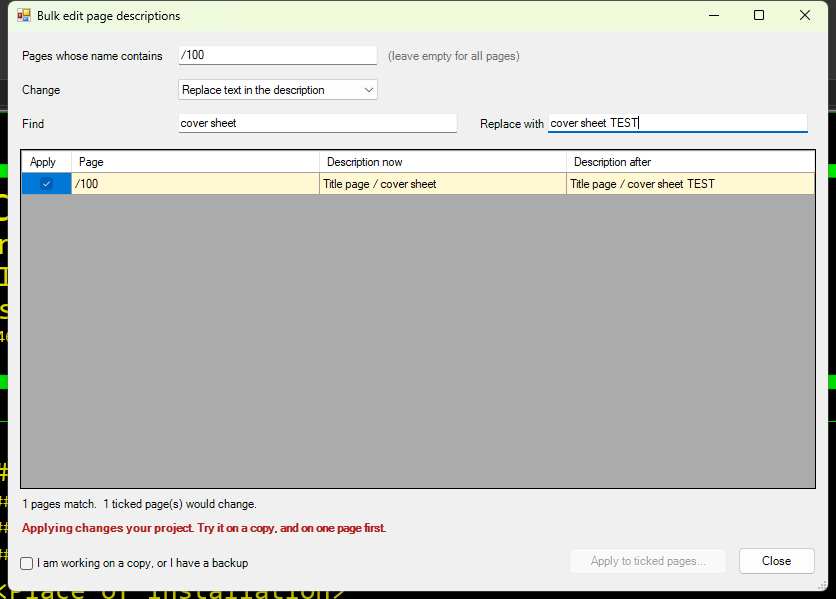

# 23 - Bulk edit pages by filter

**Level:** Advanced  **File:** [BulkEdit.cs](BulkEdit.cs)  **Status:** Run in Eplan 2026

> **The Apply step changes your project.** Showing the preview changes nothing. Try it on a copy, and on one page before many.

## What it does

Changes **one property on many pages at once**, safely:

1. **Choose the pages** by typing part of their name (leave it empty for all pages).
2. **Choose the change**: *Replace text in the description*, or *Set the description to* a new text.
3. **Look at the preview.** Every matching page is listed with its description now and its description after. Pages that would change are highlighted.
4. **Tick** the pages you want, tick "I am working on a copy, or I have a backup", press **Apply to ticked pages...**, and confirm.

After applying, the script **reads each value back** to check that Eplan really took the change, and lists any page that did not change.

This version edits the **page description** (property 11011). The same pattern works for other properties once you have found their numbers (see examples 10 and 14).

## What you will learn

- A **preview-then-confirm** design for anything that changes data
- A `DataGridView` with a **tick box column**, and making a tick count immediately
- Find-and-replace logic with a live preview
- Changing data through the data model with reflection: locking, building a property id, and setting a value
- **Reading back** after writing, to catch silent failures
- Several layers of safety: preview, tick boxes, a safety check box, a confirmation, and a result report

## How to run it

1. Open a **copy of a project** in Eplan.
2. Copy `BulkEdit.cs` to a folder on your computer.
3. Go to File > Extras > Interfaces, choose **Run** (under Scripts), and select the file.
4. Try it first with a filter that matches **one page**.

New to scripts? See [How to run a script](../../docs/running-scripts.md).

## Good to know

- Nothing is written until you press Apply and confirm.
- Descriptions are multi-language in Eplan. This version reads the English text (or the first available), and sets the new text through Eplan's text setter. Check the result on a page with several languages.
- If a page cannot be changed (for example it is write-protected), it appears in the "Not changed" list with the reason.
- This is the **riskiest example in the collection**, because it writes through reflection. Please test on a copy and report what you see.

## Compatibility

| Eplan version | Compiles | Run in Eplan |
|---------------|----------|--------------|
| 2026.0.3 | Yes | Yes (changed one page description on a copy, confirmed by reading it back) |

Checked in Eplan 2026 on a copy of a demo project, with one page: the preview showed the old and new description side by side, the 'working on a copy' box had to be ticked, the confirmation said 1 page would change, and afterwards the page list (example 09) showed that page, and only that page, with the new description. Only 'Replace text in the description' on a single page was tried. The first draft's data-model helpers needed two fixes found while testing examples 09 and 10 (see the data model guide).

## Ideas to extend

- A drop-down of properties to edit, instead of the fixed page description.
- Filter by page type or by another property.
- Save a log of every change, and make a backup first (example 26).
