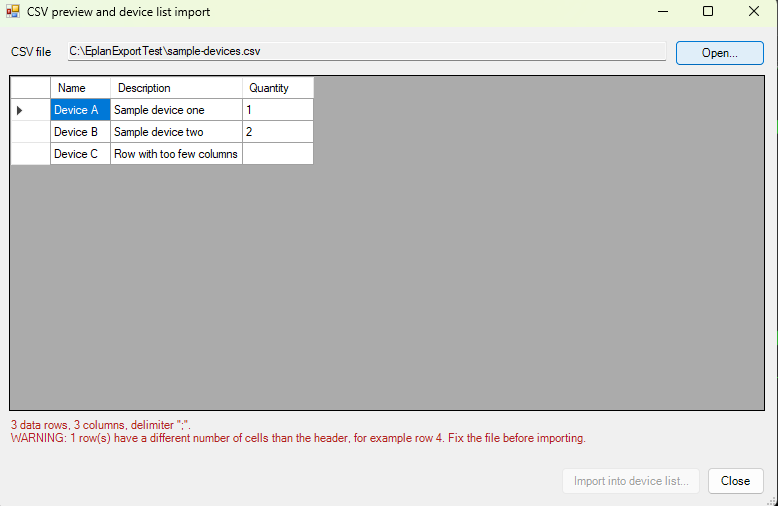

# 24 - CSV preview and device list import

**Level:** Advanced  **File:** [CsvDeviceImport.cs](CsvDeviceImport.cs)  **Status:** Run in Eplan 2026 (preview checked; import not confirmed with real data)

> **The import changes your project.** Try it on a copy first.

## What it does

Open a CSV file and see it in a grid **before** anything touches your project. The window detects the delimiter (`;`, `,` or tab), shows the first 200 rows, and **checks the file** for rows with a different number of cells than the header. Only when the file looks consistent does the **Import into device list...** button come alive. It then asks to confirm and runs Eplan's `devicelist` action with `TYPE=IMPORT`.

A typical use: people often bring device data in from another tool through an Excel list. This is a safer way to look at that list first.

## Start from an Eplan file

Eplan's CSV importer expects Eplan's own column layout. The simplest route is:
1. Export the device list from Eplan with example 18 (CSV).
2. Edit that file in Excel, keeping the header row and the column order.
3. Open it here, check the preview, and import.

This example does not map columns from some other layout. That would be a good extension.

## What you will learn

- **Parsing CSV** properly: quoted cells, commas inside quotes, doubled quotes and line breaks inside cells
- Detecting a delimiter
- Filling a `DataGridView` (add the columns first, then the rows)
- **Validating before a risky step**, and keeping the button disabled until the check passes
- Running the `devicelist` action with `TYPE=IMPORT`

## How to run it

1. Open a **copy of a project** in Eplan.
2. Copy `CsvDeviceImport.cs` to a folder on your computer.
3. Go to File > Extras > Interfaces, choose **Run** (under Scripts), and select the file.
4. Press **Open...**, choose a CSV file, read the status line, and import if it looks right.

New to scripts? See [How to run a script](../../docs/running-scripts.md).

## Good to know

- Eplan's CSV files are usually in the Windows ANSI encoding. If special characters look wrong in the preview, the file may be in another encoding.
- Only the first 200 rows are shown, but the import uses the whole file.
- The CSV reader part has no Eplan code in it. You can copy `CsvReader` into any script.

## Compatibility

| Eplan version | Compiles | Run in Eplan |
|---------------|----------|--------------|
| 2026.0.3 | Yes | Partly (preview and checks work; import action ran, effect not confirmed) |

Checked in Eplan 2026: the preview window read a semicolon CSV, showed it in a grid, reported the number of rows and columns, warned about a row with too few columns, and kept the Import button disabled until the file was consistent. The import asked for confirmation (and says to try a copy first) and the device list import action finished without an error. Not confirmed: that the rows really reach the device list. A test file with made-up column names changed nothing (a device list export afterwards still said count=0), most likely because Eplan expects its own column layout; the demo project's device list was also empty, so there was no real export to copy the layout from. Please try it with a file exported from a project that has device list data.

The CSV parsing and the checks were tested outside Eplan, including quotes, delimiters and uneven rows. The import itself needs a run in Eplan.

## Ideas to extend

- Map the columns of a different file layout to Eplan's.
- Show the rows that fail a check in red.
- Make a backup first (example 26), and report the result with example 22.
