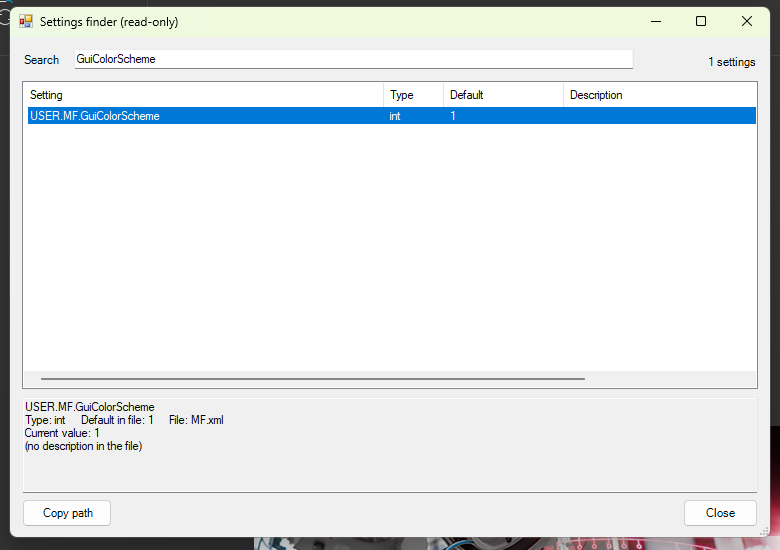

# 25 - Settings finder (read-only)

**Level:** Intermediate  **File:** [SettingsFinder.cs](SettingsFinder.cs)  **Status:** Run in Eplan 2026

## What it does

Opens a window listing the settings Eplan defines in its own configuration files. Type words in the search box to narrow the list (for example `color`, `plot frame` or `backup`). Select a setting to see its **default value in the file**, its **current value in your Eplan**, its type and its description.

Use it when you ask yourself *"which setting controls this?"*, or when a script needs the path of a setting. **Copy path** puts the setting path on the clipboard, ready to paste into a script, for example `USER.MF.GuiColorScheme`.

**It only reads.** It never changes a setting, so it is safe to try.

## What you will learn

- Reading XML with **XmlReader** and building a path from nested elements
- Filtering a list by **several words** at once
- Using a **ListView** with columns and `BeginUpdate` / `EndUpdate`
- Reading a setting's current value with the `Settings` class (the same class example 04 uses for the color scheme)
- Why a read-only tool is a good first project

## How to run it

1. Copy `SettingsFinder.cs` to a folder on your computer.
2. In Eplan, go to File > Extras > Interfaces, choose **Run** (under Scripts), and select the file.
3. Wait a moment while it reads the files, then search for `color`.

New to scripts? See [How to run a script](../../docs/running-scripts.md).

## Good to know

- The script reads the XML files in the `Cfg` folder next to Eplan's `Bin` folder. It only reads them and does not copy their text anywhere.
- It reads several hundred files and tens of thousands of settings. That took about half a second in a test, but give it a moment.
- Some settings have no value in your current session, and the window says so. A setting without a description in the file simply shows no description.
- The list stops at 1500 matches. Add another word to narrow it.

## Compatibility

| Eplan version | Compiles | Run in Eplan |
|---------------|----------|--------------|
| 2026.0.3 | Yes | Yes (search, current value, Copy path) |

Checked in Eplan 2026 with Eplan in dark mode: the window loaded Eplan's settings, searching for GuiColorScheme found USER.MF.GuiColorScheme, its current value (1, which is dark) matched Eplan's scheme, and Copy path put the setting path on the clipboard.

The file reading and search logic was tested outside Eplan against the installed `Cfg` folder.

## Ideas to extend

- Show user and station settings in separate tabs.
- Export the current values of the matching settings to a CSV file.
- Compare the current value with the default and highlight the ones you changed.
