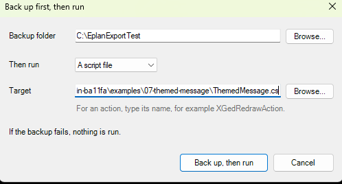

# 26 - Back up first, then run

**Level:** Intermediate  **File:** [BackupThenRun.cs](BackupThenRun.cs)  **Status:** Run in Eplan 2026

## What it does

Makes a **timestamped backup** of the current project, and **only if that worked**, runs a script or Eplan action you choose. If the backup fails, nothing is run. It is a safety net in front of anything risky: a bulk change, a renumbering, a script you are still testing.

The backup name includes the project, the date and the time, so every run is a new file. The backup's comment records what was run afterwards.

## What you will learn

- **Chaining two steps** and stopping if the first fails
- Running the `backup` action, then a script (`ExecuteScript`) or any Eplan action by name
- Telling the user exactly what happened if the second step fails after the first succeeded
- Why the safety step goes **before** the risky one

## How to run it

1. Open a project in Eplan.
2. Copy `BackupThenRun.cs` to a folder on your computer.
3. Go to File > Extras > Interfaces, choose **Run** (under Scripts), and select the file.
4. Choose a backup folder, choose what to run (for example one of the other examples in this repository), and press **Back up, then run**.

New to scripts? See [How to run a script](../../docs/running-scripts.md).

## Good to know

- Put the backup folder on a drive that is itself backed up.
- The project name comes from Eplan's path variable `$(PROJECTNAME)`. If it is not supplied, the name shows `Project`.
- If you choose an action, write it like Eplan's command line: the name, then optional `/PARAMETER:value` pairs.
- Test your backups by opening one occasionally.

## Compatibility

| Eplan version | Compiles | Run in Eplan |
|---------------|----------|--------------|
| 2026.0.3 | Yes | Yes (backup then run, and nothing runs if the backup fails) |

Checked in Eplan 2026 on a copy of a demo project: with a valid folder, the script made a backup first (named with 'before_run' and the date and time) and then started the chosen script; with a folder that does not exist the backup failed, the window said so, and the chosen script was not started. Leaving the target empty was refused with a short message.

## Ideas to extend

- Remember the last backup folder and target (example 08).
- Add a ribbon button for it (example 05), or put it in the favorites launcher (example 21).
- Offer to open the backup folder when it finishes.
