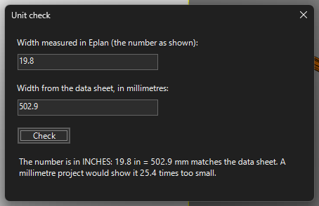

# 28 - Unit check

**Level:** Intermediate  **File:** [UnitCheck.cs](UnitCheck.cs)  **Status:** Run in Eplan 2026 and 2027

## What it does

You type the width you measured in Eplan (the number as it is shown) and the width from the data sheet in millimetres. The window says whether the number matches in millimetres or in inches, or whether it is about 25.4 times too small, which points to a drawing or model that was imported with the wrong unit.

## What you will learn

- A small form with two text boxes, a button and a result label
- Reading numbers safely (dot or comma, no crash on bad input)
- Comparing with a tolerance (2 percent here)
- Keeping the logic in its own class, so it can be tested without a window
- Why a part can be 25.4 times wrong without anyone noticing

## How to run it

1. Copy `UnitCheck.cs` to a folder on your computer.
2. In Eplan, go to File > Extras > Interfaces, choose **Run** (under Scripts), and select the file.
3. Try 19.8 and 502.9: the window says the number is in inches. Try 502.9 and 502.9: it says millimetres.

New to scripts? See [How to run a script](../../docs/running-scripts.md).

## Good to know

- **Dark mode:** the window follows Eplan's color scheme. In a dark Eplan it turns dark, and in a light one it keeps the normal Windows look. The code for this is the `UnitSkin` class at the end of the script; example 04 explains the idea.

## Compatibility

| Eplan version | Compiles | Run in Eplan |
|---------------|----------|--------------|
| 2026.0.3 | Yes | Yes (inches, millimetres, no match, bad input) |
| 2027.0.3 | Yes | Yes (run 2026-11-17 on a copy of a demo project: inches case; dark color scheme followed) |

Checked in Eplan 2026: 19.8 with 502.9 said inches, 502,9 (comma) with 502.9 said millimetres, 300 with 502.9 said no match, and text instead of a number gave the hint about plain numbers.

## Ideas to extend

- Read the width from the selected object instead of typing it (see example 14).
- Add a second dimension (height) and check both.
- Write the result to the results window from example 22.
