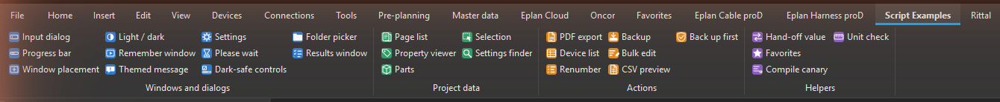

# 29 - Showcase ribbon: one tab to try every example

**Level:** Intermediate  **Files:** [ShowcaseRibbonSetup.cs](ShowcaseRibbonSetup.cs), [ShowcaseRibbonRemove.cs](ShowcaseRibbonRemove.cs), [icons/](icons/)  **Status:** Run in Eplan 2027

## What it does

Adds one tab, **Script Examples**, to Eplan's ribbon. The tab has four groups and one button for each example in this repository, so you can open any of them with a single click while you look for ideas:

| Group | Buttons |
|-------|---------|
| Windows and dialogs | Input dialog, Progress bar, Window placement, Light / dark, Remember window, Themed message, Settings, Please wait, Dark-safe controls, Folder picker, Results window |
| Project data | Page list, Property viewer, Parts, Selection, Settings finder |
| Actions | PDF export, Device list, Renumber, Backup, Bulk edit, CSV preview, Back up first |
| Helpers | Hand-off value, Favorites, Compile canary, Unit check |

Each button has its own icon and a tooltip. A button just runs the example's script with `ExecuteScript`, so the ribbon is a good way to see how your own scripts could sit in a toolbar.

Example 05 explains the basics of ribbons with two buttons. This one builds a bigger ribbon **from a table of data**: one row per button, so adding a button only takes one new line of code.

## What you will learn

- Building a whole ribbon from a list of rows instead of repeating code for every button
- Creating groups on demand, in the order of the table
- Giving every button its own SVG icon, with a group icon as a fallback
- Skipping a button politely when its script file is missing, and reporting what was skipped
- Finding the folder of your scripts when Eplan does not tell the script where it is saved

## How to load it

1. Keep the whole repository folder together on your computer (the `examples` folder with all the numbered folders). The buttons run the scripts in their folders.
2. Open Eplan and a **copy of a demo project**. Most examples need a project to be open.
3. Go to File > Extras > Interfaces, choose **Run** (under Scripts), and select `ShowcaseRibbonSetup.cs` in the folder `29-showcase-ribbon`. If a second "Open" window appears, select `ShowcaseRibbonSetup.cs` again. The script uses its folder to find the others.
4. When the message says the tab was created, **restart Eplan**. Ribbon changes appear after a restart.
5. Open the **Script Examples** tab and click any button.

To remove the tab, run `ShowcaseRibbonRemove.cs` the same way.

Running the setup again replaces the tab after you confirm, so you never get two.

New to scripts? See [How to run a script](../../docs/running-scripts.md).

## Good to know

- Some examples change project data (19 Renumber, 23 Bulk edit, 24 CSV import). Each one asks for confirmation and tells you to use a copy. Try them on a copy of a project.
- The ribbon is stored in your Eplan user settings, not in a project.
- If you want the tab to skip the "select the file" question, type the path of the `examples` folder into the `ExamplesFolder` option at the top of `ShowcaseRibbonSetup.cs`.
- Example 05 is not on this tab, because this tab is the bigger version of example 05.

## Compatibility

| Eplan version | Compiles | Run in Eplan |
|---------------|----------|--------------|
| 2026.0.3 | Yes | Pending |
| 2027.0.3 | Yes | Yes (run 2026-11-17: tab created, Eplan restarted, the tab, groups and icons appeared, and the buttons started the examples) |

## Ideas to extend

- Read the list of buttons from a small text or JSON file, so people can change the ribbon without editing code.
- Add a second tab for your own team's scripts.
- Add a **Remove tab** button to the ribbon itself.
